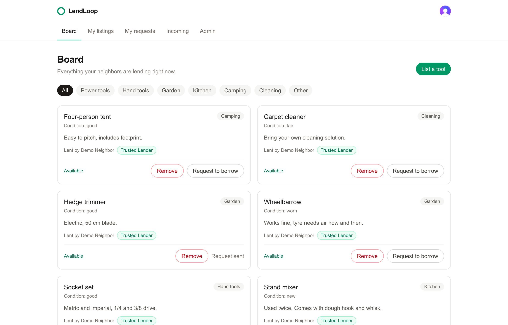
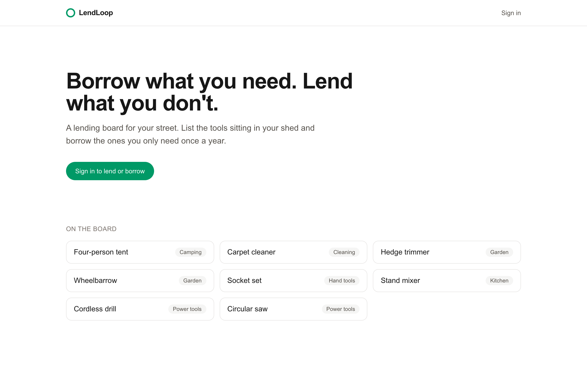
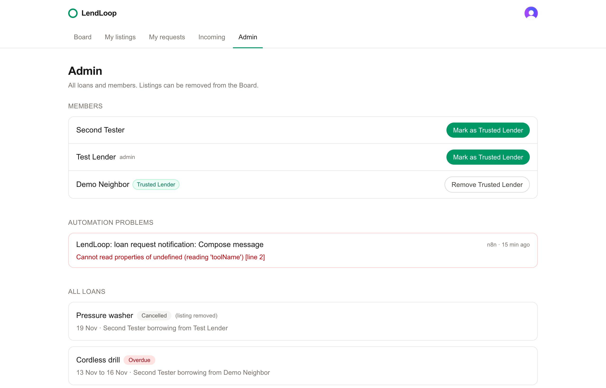

# LendLoop

A neighborhood tool-lending board. Neighbors list tools they are willing to lend, ask to borrow each other's tools for a date range, and get notifications and overdue reminders through n8n workflows.

**Stack:** Next.js 16 (App Router), TypeScript, Clerk, Convex, n8n in Docker.



- Public landing page with a read-only list of tools (name and category only).
- Signed-in board with category filter and live availability, own listings, borrow requests, incoming requests.
- Two roles. Admins can remove any listing, see every loan and mark members as Trusted Lenders.
- Every rule is enforced in Convex functions, not just in the UI.
- Three n8n workflows: loan notifications, daily overdue reminders and an error handler. All traffic between Convex and n8n is HMAC-signed in both directions, retried on failure and recorded idempotently.

## Contents

- [Screenshots](#screenshots)
- [Architecture](#architecture)
- [Project structure](#project-structure)
- [Local setup](#local-setup)
- [Environment variables](#environment-variables)
- [Using the app](#using-the-app)
- [Roles and access control](#roles-and-access-control)
- [Data model](#data-model)
- [Automation with n8n](#automation-with-n8n)
- [Security and data minimization](#security-and-data-minimization)
- [Tests](#tests)
- [What I would change for production](#what-i-would-change-for-production)

## Screenshots

| Public landing page | Admin page |
| --- | --- |
|  |  |

The landing page shows only tool names and categories. The admin page lists members with the Trusted Lender toggle, failed automation runs, and every loan.

## Architecture

```
              ┌──────────────┐    sign in    ┌─────────┐
  Browser ───>│ Next.js (UI) │<─────────────>│  Clerk  │
              └──────┬───────┘      JWT      └─────────┘
                     │ queries and mutations with the Clerk JWT
                     v
              ┌────────────────────────────────────────────┐
              │ Convex                                     │
              │   queries and mutations   access rules     │
              │   scheduled actions       outgoing webhooks│
              │   HTTP actions /n8n/*     signed, inbound  │
              │   database                                 │
              └──────┬─────────────────────────────▲───────┘
         loan events │                             │  overdue fetch, write-back
         signed POST v                             │  and error reports, signed POST
              ┌──────────────────────────┐         │
              │ Caddy gateway            │         │
              │ only /webhook/* passes   │         │
              │ (via tunnel in dev)      │         │
              └──────┬───────────────────┘         │
                     v                             │
              ┌────────────────────────────────────┴───────┐
              │ n8n (Docker)                               │
              │   1. loan notification                     │
              │   2. daily overdue reminders               │
              │   3. error handler                         │
              └────────────────────────────────────────────┘
```

- **Next.js** renders the UI and talks to Convex directly through the Convex React client. It has no API routes of its own.
- **Clerk** handles sign-in. Convex accepts only Clerk tokens from the `convex` JWT template and reads the user from the verified token.
- **Convex** is the single source of truth. Every read and write goes through a Convex function that checks who is calling. Loan changes schedule an action that notifies n8n; n8n calls back into Convex through signed HTTP actions.
- **n8n** runs in Docker with a small Caddy gateway in front. Only webhook paths go through the gateway, so the n8n editor is never exposed. In development, Convex (in the cloud) reaches the gateway through a Cloudflare quick tunnel.

## Project structure

```
app/                      Next.js routes
  page.tsx                public landing page
  board/                  signed-in pages: board, listings, requests, incoming
  admin/                  admin page
components/               UI building blocks, auth gate, header, user sync
convex/
  schema.ts               tables and indexes
  model.ts                shared enums (categories, conditions, statuses)
  access.ts               requireUser / requireAdmin / ownership helpers
  rules.ts                date and text validation
  users.ts                profile sync, roles, Trusted Lender
  tools.ts                listings and the board
  loans.ts                borrow requests and their lifecycle
  notifications.ts        outgoing signed webhook with retries
  reminders.ts            overdue lookup and idempotent write-back
  health.ts               failure reports and the admin problem list
  http.ts                 signed HTTP actions used by n8n
  signing.ts              HMAC sign and verify
  seed.ts                 demo data (internal, CLI only)
  *.test.ts               convex-test suites
n8n/
  docker-compose.yml      n8n + Caddy gateway
  Caddyfile               forwards only /webhook/*
  workflows/              exported workflow JSON
docs/screenshots/         images used in this README
proxy.ts                  Clerk middleware and route protection
```

## Local setup

Requirements: Node.js 20.9+, Docker, a Clerk account, a Convex account, and `cloudflared` for the tunnel (`brew install cloudflared`).

### 1. App

1. Install dependencies:

   ```bash
   npm install
   ```

2. Create a Clerk application and put its development keys in `.env.local` (see `.env.example`). With the Clerk CLI: `npx clerk link`, then `npx clerk env pull`.

3. In Clerk, add a JWT template named `convex` with exactly these claims:

   ```json
   { "aud": "convex", "name": "{{user.full_name}}", "email": "{{user.primary_email_address}}" }
   ```

4. Start Convex. The first run creates a dev deployment and writes its URLs to `.env.local`. Leave it running.

   ```bash
   npx convex dev
   ```

5. Tell Convex which Clerk instance to trust:

   ```bash
   npx convex env set CLERK_JWT_ISSUER_DOMAIN https://<your-instance>.clerk.accounts.dev
   ```

6. Optionally add demo listings so the board is not empty. Running it twice does nothing the second time.

   ```bash
   npx convex run seed:run
   ```

7. In a second terminal, start the app and open http://localhost:3000:

   ```bash
   npm run dev
   ```

8. Sign in once so your user row exists, then make yourself an admin:

   ```bash
   npx convex run users:setRole '{"email":"you@example.com","role":"admin"}'
   ```

   `setRole` is an internal mutation. There is deliberately no way to become admin from inside the app, so only someone with access to the Convex deployment can hand out the role.

### 2. n8n

1. Create `n8n/.env` from `n8n/.env.example`. Generate both secrets with `openssl rand -hex 32` and set `CONVEX_SITE_URL` to `NEXT_PUBLIC_CONVEX_SITE_URL` from `.env.local`.

2. Give Convex the same shared secret:

   ```bash
   npx convex env set LENDLOOP_WEBHOOK_SECRET <same value as in n8n/.env>
   ```

3. Start n8n and the gateway, then import and publish the three workflows:

   ```bash
   npm run n8n:up
   npm run n8n:import
   ```

   The editor is at http://localhost:5678. Create the owner account on first visit.

4. Convex runs in the cloud, so it needs a public URL to reach your local n8n. Start a tunnel to the gateway (port 5680, not n8n itself) and give Convex the webhook URL:

   ```bash
   cloudflared tunnel --url http://127.0.0.1:5680
   ```

   ```bash
   npx convex env set N8N_LOAN_EVENT_WEBHOOK_URL https://<random>.trycloudflare.com/webhook/lendloop-loan-event
   ```

   A quick tunnel gets a new URL every time it starts, so set the variable again after restarting it.

5. Check it works: request a tool in the app as one user, then look at the n8n executions list. The `automationEvents` table in the Convex dashboard should show the notification as `sent`.

## Environment variables

| Variable | Where | Purpose |
| --- | --- | --- |
| `NEXT_PUBLIC_CLERK_PUBLISHABLE_KEY` | `.env.local` | Clerk frontend key. |
| `CLERK_SECRET_KEY` | `.env.local` | Clerk backend key, used by the Next.js middleware. Never sent to the browser. |
| `CONVEX_DEPLOYMENT` | `.env.local` | Written by `npx convex dev`. |
| `NEXT_PUBLIC_CONVEX_URL` | `.env.local` | Convex client URL, written by `npx convex dev`. |
| `NEXT_PUBLIC_CONVEX_SITE_URL` | `.env.local` | Convex HTTP actions URL, written by `npx convex dev`. |
| `CLERK_JWT_ISSUER_DOMAIN` | Convex deployment | Issuer that Convex trusts for Clerk tokens. |
| `LENDLOOP_WEBHOOK_SECRET` | Convex deployment and `n8n/.env` | Shared HMAC secret for both directions. Must match. |
| `N8N_LOAN_EVENT_WEBHOOK_URL` | Convex deployment | Public URL of the n8n loan event webhook. |
| `N8N_ENCRYPTION_KEY` | `n8n/.env` | Encrypts credentials stored inside n8n. |
| `CONVEX_SITE_URL` | `n8n/.env` | Where n8n sends its signed requests. |
| `N8N_PUBLIC_URL` | `n8n/.env` | Optional. Public base URL n8n shows for its webhooks. |
| `GENERIC_TIMEZONE` | `n8n/.env` | Timezone for the 08:00 schedule. Defaults to `Europe/Zagreb`. |

Convex deployment variables are set with `npx convex env set NAME value` or in the Convex dashboard. `.env.local` and `n8n/.env` are git-ignored.

## Using the app

| Page | What it does |
| --- | --- |
| `/` | Public landing page with the read-only tool list. |
| `/board` | Every listed tool with condition, lender, Trusted Lender badge and availability. Filter by category and request a date range. Tools you already asked for show "Request sent". Admins also get a Remove button on every listing. |
| `/board/listings` | Your own listings: add, edit, remove. Shows open requests per tool. |
| `/board/requests` | Tools you asked to borrow and their status. Open requests can be cancelled. |
| `/board/incoming` | Requests for your tools: approve, decline, mark returned. |
| `/admin` | Admins only: members with the Trusted Lender toggle, automation problems, and all loans. |

`/board` and `/admin` are protected in `proxy.ts`, so signed-out visitors are sent to sign in before the page loads. That is a convenience; the Convex functions behind each page check access on their own.

### Loan rules

- A loan moves from `requested` to `approved`, `declined` or `cancelled`, and from `approved` to `returned`. Any other transition is refused.
- You cannot borrow your own tool, and you can have only one open request per tool.
- Dates must be valid, the start cannot be in the past, and a loan lasts at most 30 days.
- Requests and approvals that overlap an already approved loan for the same tool are refused, so a tool is never promised to two people for the same day.
- A tool counts as on loan from the start date of an approved loan until the lender marks it returned. An approved loan past its end date shows as overdue.
- Removing a listing cancels its open requests and notifies the borrowers. Approved loans stay, since the tool may still be with the borrower.

## Roles and access control

Two roles: `admin` and `user`. Every rule is checked inside Convex functions with the helpers in `convex/access.ts`. The UI hides buttons a user cannot use, but the backend is the source of truth.

| Helper | Allows |
| --- | --- |
| `requireUser` | Any signed-in user that has a `users` row. |
| `requireAdmin` | Admins only. |
| `requireToolOwner` | Only the owner of the listing. Used for editing; admins cannot edit other people's listings. |
| `requireToolOwnerOrAdmin` | The owner or an admin. Used for removing a listing. |
| `requireLoanLender` | The owner of the borrowed tool. Used for approve, decline and mark returned. |
| `requireLoanBorrower` | The borrower. Used for cancelling a request. |

How identity works:

- Clerk handles sign-in. `proxy.ts` runs Clerk's middleware (Next.js 16 renamed `middleware.ts` to `proxy.ts`).
- `ConvexProviderWithClerk` gets a token from the `convex` JWT template and sends it with every Convex request.
- `convex/auth.config.ts` accepts only tokens issued by our Clerk instance with audience `convex`. Inside functions the caller comes from `ctx.auth.getUserIdentity()`, matched on `tokenIdentifier`. No function accepts a user id as proof of who the caller is.
- After sign-in the app calls `users.store`, which creates the user row on first visit and keeps name and email in sync. New users always start as `user` with `trustedLender: false`.
- Errors are thrown as `ConvexError` with a code (`UNAUTHENTICATED`, `NO_ACCOUNT`, `FORBIDDEN`, `NOT_FOUND`, `INVALID`, `CONFLICT`) so the UI can show a clear message.

## Data model

Defined in `convex/schema.ts`. Shared enums live in `convex/model.ts` so the backend and the UI use the same values.

| Table | Purpose |
| --- | --- |
| `users` | One row per Clerk user, keyed by `tokenIdentifier`. Holds `role` and the `trustedLender` flag. |
| `tools` | A listing: owner, name, category, condition, short description. Removing a listing sets `removedAt` instead of deleting it, so loan history keeps pointing at a real tool. |
| `loans` | A borrow request for a date range and its lifecycle. Dates are `YYYY-MM-DD` strings so they compare correctly as text. `ownerId` is copied from the tool so incoming requests are a single index lookup. |
| `automationEvents` | What the automations did for a loan: notification sent, reminder sent, or failure. `idempotencyKey` is unique per action, so a retry cannot write the same event twice. |
| `integrationFailures` | Failed n8n runs reported by the error workflow, one row per execution. |

## Automation with n8n

All three workflows are exported in `n8n/workflows/` and imported with `npm run n8n:import`.

### Workflow 1: loan notification

`n8n/workflows/loan-request-notification.json`

```
Convex mutation ──schedules──> deliver action ──signed POST──> gateway ──> n8n webhook
                                     │                                         │
                                     └── automationEvents (sent / failed) <────┘
```

1. Every loan transition (`requested`, `approved`, `declined`, `cancelled_by_borrower`, `listing_removed`, `returned`) schedules `notifications.deliver` inside the same mutation, so a notification is only queued if the change itself commits.
2. The action builds a minimal payload: the event, the recipient's name and email, the other person's display name, tool name, dates and status. The other person's email is never included.
3. The body is signed with HMAC-SHA256 over `<timestamp>.<raw body>` and sent with `X-LendLoop-Timestamp` and `X-LendLoop-Signature` headers.
4. In n8n, the first node after the webhook recomputes the signature over the raw request bytes, compares it in constant time and rejects anything older than five minutes. Invalid requests get a 401 and go no further.
5. A dedupe step remembers handled `eventId`s for seven days, so a retried delivery is acknowledged without notifying anyone twice.
6. The notification is a mock: n8n composes the message and records it in the execution log with the email masked (`o***@example.com`). Swapping in an Email or Slack node is a one-node change.

### Workflow 2: daily overdue reminders

`n8n/workflows/daily-overdue-reminders.json`

```
08:00 ──> sign {date} ──> POST /n8n/overdue-loans ──> one item per loan ──> mock reminder ──> sign ──> POST /n8n/reminder-status
```

1. A Schedule Trigger runs every day at 08:00 (`GENERIC_TIMEZONE`). A manual trigger is there for testing.
2. n8n signs `{"date": "YYYY-MM-DD"}` and posts it to `/n8n/overdue-loans`. Convex verifies the signature and timestamp, accepts only a date within a day of its own clock, and returns approved loans past their end date: borrower name and email, lender name, tool, due date, days overdue and a `reminderKey`. Loans already reminded that day are left out.
3. For each loan n8n composes a reminder, logs it with the email masked, signs `{loanId, date, outcome, detail}` and posts it to `/n8n/reminder-status`.
4. Convex writes the status to `automationEvents` under `reminder:<loanId>:<date>`. A retry or a second run on the same day finds the existing row and changes nothing (a `failed` row can be upgraded to `sent`, never the reverse).

To try it without waiting for 08:00, create an overdue loan and run the workflow once:

```bash
npx convex run seed:overdueDemo '{"borrowerEmail":"you@example.com"}'
```

```bash
docker compose -f n8n/docker-compose.yml exec -e N8N_RUNNERS_BROKER_PORT=5690 n8n n8n execute --id=lendloopOverdue01
```

The extra broker port is only needed because the CLI starts a second n8n process next to the running one.

### Workflow 3: error handler

`n8n/workflows/error-handler.json`

Both workflows above name this one as their error workflow, so any failed run (a node throwing, Convex unreachable after all retries, a bad payload) starts it. It summarizes the failure (workflow, failed node, execution id, error message with email addresses replaced by `[email]`), signs it and posts it to `/n8n/workflow-error`. Convex stores it in `integrationFailures`, keyed by execution id so a retried report is stored once.

The admin page lists these next to failed deliveries recorded by Convex itself under "Automation problems", so a broken integration is visible in the app, not only in a log.

### Retries

| Where | What is retried | Schedule |
| --- | --- | --- |
| Convex to n8n (loan events) | Network errors, timeouts, 429 and 5xx | 30 s, 2 min, 10 min, then recorded as `failed` |
| Convex to n8n | 4xx, for example a rejected signature | Not retried, recorded as `failed` right away |
| n8n to Convex (reminder fetch and write-back) | Any failed HTTP call | 3 tries, 5 s apart, then the error workflow runs |
| n8n to Convex (error report) | Any failed HTTP call | 5 tries, 5 s apart |

## Security and data minimization

**Access control**

- Every query and mutation checks the caller with the helpers in `convex/access.ts`; the UI is never trusted.
- Admin rights can only be granted from the CLI (`users:setRole`), never from the app.
- Seed, role and webhook bookkeeping functions are internal, so they cannot be called from a browser.

**Data minimization**

- The `convex` JWT template carries only `aud`, `name` and `email`. Nothing else from the Clerk profile reaches the backend.
- The public tool list returns only `name` and `category`. Owner, condition, description and ids are dropped on the server, not just hidden in the UI.
- Signed-in users see each other's display name only. Email addresses are stored for notifications but never returned to the browser, not even to admins.
- Webhook payloads carry only what the message needs. A borrower's notification never contains the lender's email and the other way round.
- n8n execution logs mask email addresses, and error reports replace them with `[email]` before they leave n8n.

**Integration security**

- Requests in both directions are signed with HMAC-SHA256 over the timestamp and the exact raw body. Signatures are checked in constant time (`crypto.subtle.verify` in Convex, `crypto.timingSafeEqual` in n8n).
- Requests older than five minutes are rejected to limit replays, and the reminder endpoints only accept today's date.
- Write-backs are idempotent (`reminder:<loanId>:<date>`, `notify:<loanId>:<event>`, one failure row per execution), so retries never create duplicates.
- Only `/webhook/*` is reachable through the gateway. The n8n editor and REST API stay on localhost, and request bodies are capped at 64 KB.
- Convex HTTP actions validate every field of the body and cap its size at 16 KB.

**Secrets**

- Secrets live only in `.env.local`, `n8n/.env` (both git-ignored) and the Convex deployment's environment variables.
- The exported workflow JSON reads the secret through `$env.LENDLOOP_WEBHOOK_SECRET` and contains no secret values.
- To allow that, `N8N_BLOCK_ENV_ACCESS_IN_NODE` is turned off for this instance. That is a trade-off for a local setup; see the production notes.

## Tests

```bash
npm run typecheck
npm run lint
npm test
npm run build
```

`npm run build` needs `.env.local` with at least `NEXT_PUBLIC_CONVEX_URL` and the Clerk keys. Without them it stops with "No address provided to ConvexReactClient".

39 tests with `convex-test` and Vitest against an in-memory Convex backend.

- **Access:** signs in as an owner, a borrower, an unrelated user and an admin, and checks that every forbidden action is refused, not only that allowed ones work.
- **Loans:** the full lifecycle, invalid date ranges, overlapping bookings, duplicate requests and who can see which loans.
- **Notifications:** mocks `fetch` and checks the signature, the exact payload fields, retries on 5xx, no retry on 4xx, the failure record when configuration is missing, and that each event is recorded once.
- **Reminders:** calls the HTTP actions with signed, unsigned, wrongly signed and replayed requests, and checks that the write-back is idempotent.
- **Health:** the error report endpoint and that only admins can read the problem list.

### Manual checks

Besides the automated tests, the full flow was checked by hand against the dev deployment with two users and an admin: listing, editing and removing tools, requesting, declining, approving, returning, overdue reminders, Trusted Lender and the admin problem list. Anonymous and cross-user calls straight to the Convex API (signed-in queries, internal functions, someone else's listing or loan) and unsigned, forged or oversized requests to the HTTP actions and the n8n gateway were all refused.

## What I would change for production

**Hosting and reliability**

- Run n8n on an always-on server or n8n Cloud with a stable HTTPS domain instead of a laptop and a quick tunnel. During development the 08:00 run was skipped once simply because the laptop was asleep.
- Run n8n with PostgreSQL instead of SQLite, task runners in external mode, and queue mode if load grows. Keep the editor behind SSO or a VPN.
- Use separate Clerk and Convex production instances, deployed from CI (`npx convex deploy`) after type checks, lint and tests pass.

**Security**

- Use a separate secret for each direction and include a key id in the signature header, so secrets can be rotated without downtime.
- Move the HMAC secret into n8n credentials or an external secret store and turn `N8N_BLOCK_ENV_ACCESS_IN_NODE` back on.
- Add rate limits on borrow requests and new listings (for example `@convex-dev/rate-limiter`).
- Keep an audit log of admin actions: role changes, Trusted Lender changes and removed listings.

**Data and privacy**

- Add retention rules: delete `automationEvents` and `integrationFailures` after a set period.
- Handle Clerk `user.deleted` webhooks to anonymize a user's data, and `user.updated` to sync profile changes without waiting for the next sign-in.
- Store each user's timezone. Overdue status is currently computed on UTC calendar days.

**Product**

- Send real emails through a provider such as Postmark or SES, with templates and per-user notification preferences.
- Move the n8n dedupe state from workflow static data into a database, so it survives a reinstall and works with several n8n workers.
- Paginate the board and loan lists (they currently load up to 200 rows).
- Add Sentry for the frontend, ship Convex logs to a log service, and alert an admin on new integration failures instead of only listing them.
- Add end-to-end browser tests with Playwright and `@clerk/testing`.
